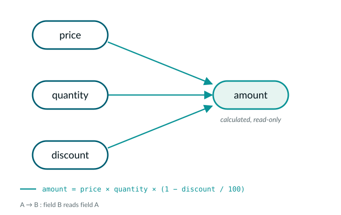
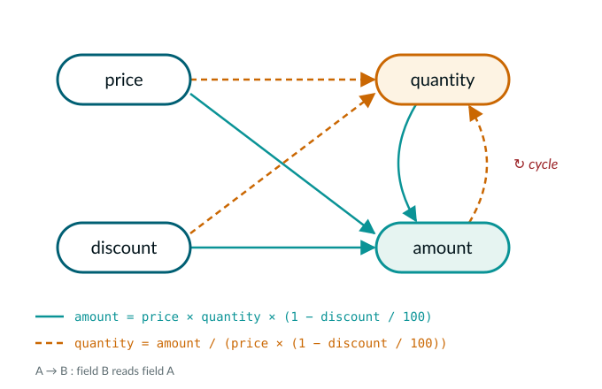
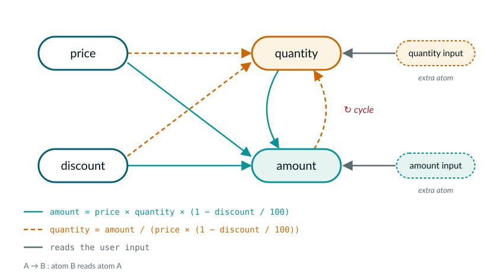
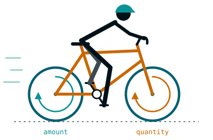

In this post I'd like to approach reactivity from a slightly different angle. Let's explore the topic of circular calculations and how they help to ease garbage collection pressure in a typical data application.

Normally, circular calculations are not allowed in reactive systems. This makes such systems simple and is enough for a common use case of rendering a UI.

Imagine the following quoting tool:

{% livecodes https://livecodes.io/?html=%3Clink%20rel%3D%22stylesheet%22%20href%3D%22https%3A%2F%2Fcanonic-epicure.github.io%2Freactivity_examples%2Fdist_quoting_tool_simple%2Fresources%2Fstyling%2Fall.css%22%3E%0A%3Cscript%20type%3D%22module%22%20src%3D%22https%3A%2F%2Fcanonic-epicure.github.io%2Freactivity_examples%2Fdist_quoting_tool_simple%2Fquoting_tool_simple.js%22%3E%3C%2Fscript%3E&mode=result&tools=none height=230 %}

It calculates the amount based on the input data.



So far so good. Then, a typical business requirement will be - the user should be able to write into the "amount" field, and the "quantity" field should be updated as a result.

Notice 2 problems:

- The "amount" field becomes writable
- The "quantity" field becomes calculable



A cycle appears! This is where a usual reactive system will break - a simple 1 to 1 correspondence between atoms and fields will no longer be viable. To solve this issue you need to introduce an extra atom for every atom in the cycle, which will represent the user's input on the atom. Having these extra atoms, one can read them, and based on their values, decide which direction to choose.



Meanwhile, this circular requirement is very common, and pretty much all atoms of a data replica will have this dual nature. Doubling the number of atoms in the application is a questionable solution. It will not only double the memory usage, but also significantly increase the garbage collection load.

Additionally, practice shows that writing code that selects a calculation direction by hand very quickly results in heavily spaghettied and fragile code. This is because of the combinatorial explosion: each atom can be in 8 states (a combination of 3 flags): has previous value / has no previous value, has user input / has no user input, keep value / do not keep value. Then, if a cycle consists of 5 atoms, the input state has 8 ^ 5 = 32768 combinations. To be robust, your code needs to branch through all of those and provide a correct answer for each. Not feasible.

The solution is to "solve" a cycle statically. First, we need to describe it as a collection of formulas:

```ts
export const PriceVar       = Symbol('Price')
export const QuantityVar    = Symbol('Quantity')
export const DiscountVar    = Symbol('Discount')
export const AmountVar      = Symbol('Amount')

export const amountFormula      = Formula.new({
    output      : AmountVar,
    inputs      : new Set([ PriceVar, QuantityVar, DiscountVar ])
})

export const quantityFormula    = Formula.new({
    output      : QuantityVar,
    inputs      : new Set([ PriceVar, AmountVar, DiscountVar ])
})

const cycleDescription = CycleDescription.new({
    variables           : new Set([ PriceVar, QuantityVar, DiscountVar, AmountVar ]),
    formulas            : new Set([ amountFormula, quantityFormula ])
})

// when there's no "preference" from the user input (for example, only the `price` has been changed),
// the `amount` is calculated
const cycleResolution = CycleResolution.new({
    description                 : cycleDescription,
    defaultResolutionFormulas   : new Set([ amountFormula ])
})
```

Then, for every cycle instance we create a single atom (instead of one atom for every atom in the cycle). That atom is called a "dispatcher". The dispatcher reads the input states of every atom in the cycle and feeds them into the cycle resolver. The cycle resolver then selects an optimal data flow to use for this cycle (and memoizes the resolution). The dispatcher atom is then read by all atoms of the cycle and all of them follow the same resolution scenario.

```ts
    @calculate('amount')
    calculateAmount () : number {
        const instruction : FormulaId = this.dispatcher.resolution.get(AmountVar)

        if (instruction === amountFormula.formulaId) {
            // use formula
        }
        else if (instruction === CalculateProposed) {
            // use user provided value
        }
    }


    @calculate('quantity')
    calculateQuantity () : number {
        const instruction : FormulaId = this.dispatcher.resolution.get(QuantityVar)

        if (instruction === quantityFormula.formulaId) {
            // use formula
        }
        else if (instruction === CalculateProposed) {
            // use user provided value
        }
    }
```

As a result, we receive a reactive system where cycles are resolved based on the user input. The memory usage increase is negligible.

Try it here, enter some value into the "amount" field:

{% livecodes https://livecodes.io/?html=%3Clink%20rel%3D%22stylesheet%22%20href%3D%22https%3A%2F%2Fcanonic-epicure.github.io%2Freactivity_examples%2Fdist_quoting_tool%2Fresources%2Fstyling%2Fall.css%22%3E%0A%3Cscript%20type%3D%22module%22%20src%3D%22https%3A%2F%2Fcanonic-epicure.github.io%2Freactivity_examples%2Fdist_quoting_tool%2Fquoting_tool.js%22%3E%3C%2Fscript%3E&mode=result&tools=none height=230 %}

This approach scales reasonably well with the number of variables in a cycle, however extending a cycle with additional variables or composing several cycles with shared variables remains a topic of research.

Full code for this example is available [here](https://github.com/canonic-epicure/reactivity_examples/tree/master/packages/examples/src/quoting_tool).

Happy cycling!


